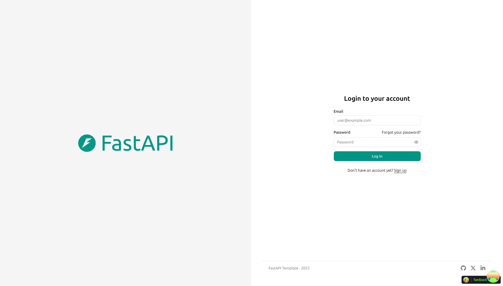
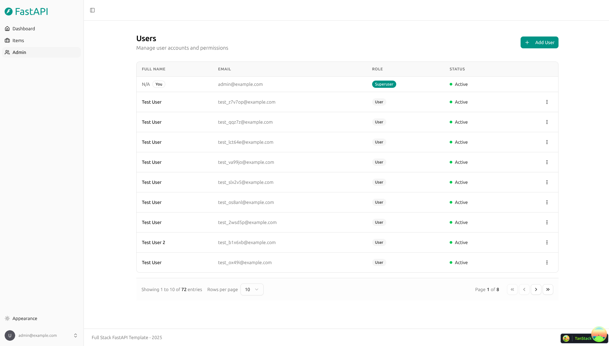
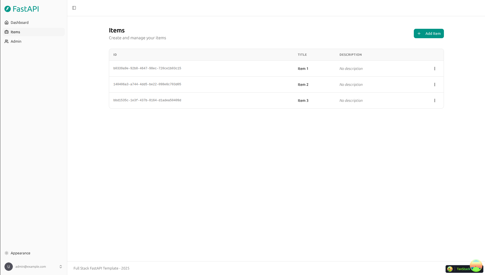
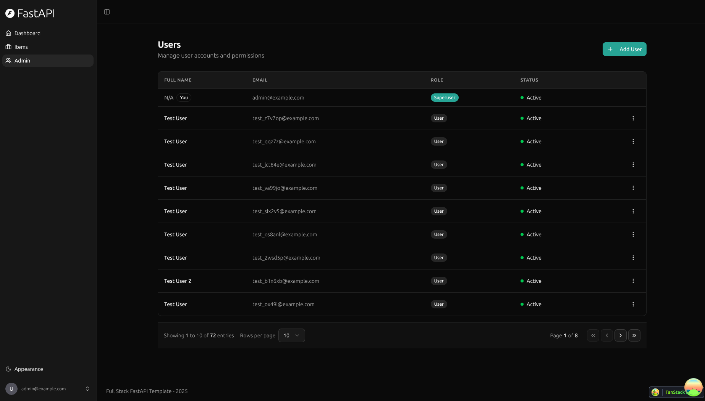

# Fullstack Dev Test Task

Role-based access on the [Full Stack FastAPI Template](https://github.com/fastapi/full-stack-fastapi-template). Admins, managers, and members share one permission matrix, enforced on the API and reflected in the UI.

Imported from `master` at `aabb90126964a164e02aff39e7c385bb0598236d` (2026-11-03, "Update release notes").

## Run locally

Template runbooks:

- Local FastAPI, Vite, Docker Compose, and `.env`: [development.md](./development.md)
- Backend: [backend/README.md](./backend/README.md)
- Frontend: [frontend/README.md](./frontend/README.md)
- FastAPI Cloud deployment: [deployment.md](./deployment.md)
- Self-hosted Docker Compose deployment: [deployment-docker-compose.md](./deployment-docker-compose.md)

PostgreSQL and Mailpit run in Docker Compose. The API and the Vite dev server run on the host.

```bash
docker compose up -d db mailpit
```

From `backend`, install dependencies, apply migrations, and seed users:

```bash
uv sync
uv run bash scripts/prestart.sh
uv run fastapi dev
```

`scripts/prestart.sh` runs `alembic upgrade head`, then creates the initial users. The role column is added by revision `c3b8e1a70d54`. To migrate without seeding:

```bash
uv run alembic upgrade head
```

From the repository root, in another terminal:

```bash
bun install
bun run dev
```

| Service | URL |
|---------|-----|
| Frontend | http://localhost:5173 |
| API | http://localhost:8000 |
| Swagger UI | http://localhost:8000/docs |
| Mailpit | http://localhost:8025 |

To run the backend and the built frontend together:

```bash
docker compose run --rm backend bash scripts/prestart.sh
docker compose watch
```

The app is then served at http://localhost:8000. Stop a host FastAPI process first, because both use port 8000.

### Seeded users

`prestart.sh` creates these accounts when the emails are not already present. All three use `FIRST_SUPERUSER_PASSWORD` from `.env`. The tracked local value is `changethis`. Do not reuse it outside local development.

| Email | Role |
|-------|------|
| `admin@example.com` | admin (`FIRST_SUPERUSER`) |
| `manager@example.com` | manager |
| `member@example.com` | member |

### Tests

From `backend`, with Postgres running and migrations applied:

```bash
FASTAPI_ENV=development uv run pytest tests/api/routes/test_authorization.py tests/api/routes/test_users.py
```

The full backend suite, with coverage:

```bash
FASTAPI_ENV=development uv run bash scripts/test.sh
```

## Permission matrix

| Action | admin | manager | member |
|--------|-------|---------|--------|
| List all users | yes | yes | no |
| Create user | yes | no | no |
| View metrics | yes | yes | no |
| Update own profile | yes | yes | yes |
| Update any profile | yes | no | no |
| Delete a user | yes | no | no |

A user can read their own record. Reading another user by id is admin-only. Managers use the user list. Signup is public and always creates a member. Items stay available to every signed-in user and remain limited to the owner, as in the template.

## Authorization

Authentication is unchanged. `get_current_user` in `backend/app/api/deps.py` validates the JWT, loads the user, and rejects inactive accounts. Authorization is a second dependency, `require_role(...)`, on the routes that need it. List users and `GET /api/v1/metrics/` allow `admin` and `manager`. Create, update, and delete by id allow `admin` only. A signed-in user of any role can read and update `/api/v1/users/me`. A missing token is 401. A known user with the wrong role is 403.

The role is a column on `user`, stored as the PostgreSQL enum `userrole` with values `admin`, `manager`, and `member`. The default is `member`. `is_superuser` remains so existing template checks keep working, and it is true only for admins. `create_user` and `update_user` keep the two fields aligned: an explicit role wins, `is_superuser=true` promotes the user to admin, and `is_superuser=false` becomes member unless that user is already a manager. The migration backfills current superusers to `admin` and adds a check constraint so the columns cannot diverge. Signup builds the user as `member`. `UserUpdateMe` has no role field, so `PATCH /api/v1/users/me` cannot change it.

The UI reads `role` from `GET /api/v1/users/me`. `can(role, action)` in `frontend/src/lib/permissions.ts` mirrors the matrix and hides Admin, Metrics, Add User, and the edit and delete actions. Opening `/admin` or `/metrics` without that capability redirects to `/forbidden`, which shows Access Denied. Hiding a link is not the security check. The API still rejects the call.

Critical paths are covered in `backend/tests/api/routes/test_authorization.py`: member denied and manager allowed on list and metrics, manager denied and admin allowed on create, a member updating self but not another user, and signup plus own-profile update refusing a role change.

## Technology stack

- [FastAPI](https://fastapi.tiangolo.com) for the Python backend API.
  - [SQLModel](https://sqlmodel.tiangolo.com) for SQL database access.
  - [Pydantic](https://docs.pydantic.dev) for validation and settings.
  - [PostgreSQL](https://www.postgresql.org) as the database.
- [React](https://react.dev) for the frontend.
  - TypeScript, hooks, and [Vite](https://vitejs.dev).
  - [Tailwind CSS](https://tailwindcss.com) and [shadcn/ui](https://ui.shadcn.com).
  - An OpenAPI-generated frontend client.
  - [Playwright](https://playwright.dev) for end-to-end tests.
- [Docker Compose](https://www.docker.com) for local services, with [Traefik](https://traefik.io) available for self-hosted deployment.
- JWT authentication, password hashing, and email-based password recovery.
- [Mailpit](https://mailpit.axllent.org) for local email testing.
- [Pytest](https://pytest.org) for backend tests.

### Dashboard login



### Dashboard admin



### Dashboard items



### Dark mode



Release notes: [release-notes.md](./release-notes.md).

## License

The imported Full Stack FastAPI Template is licensed under the MIT license. See [LICENSE](./LICENSE).
